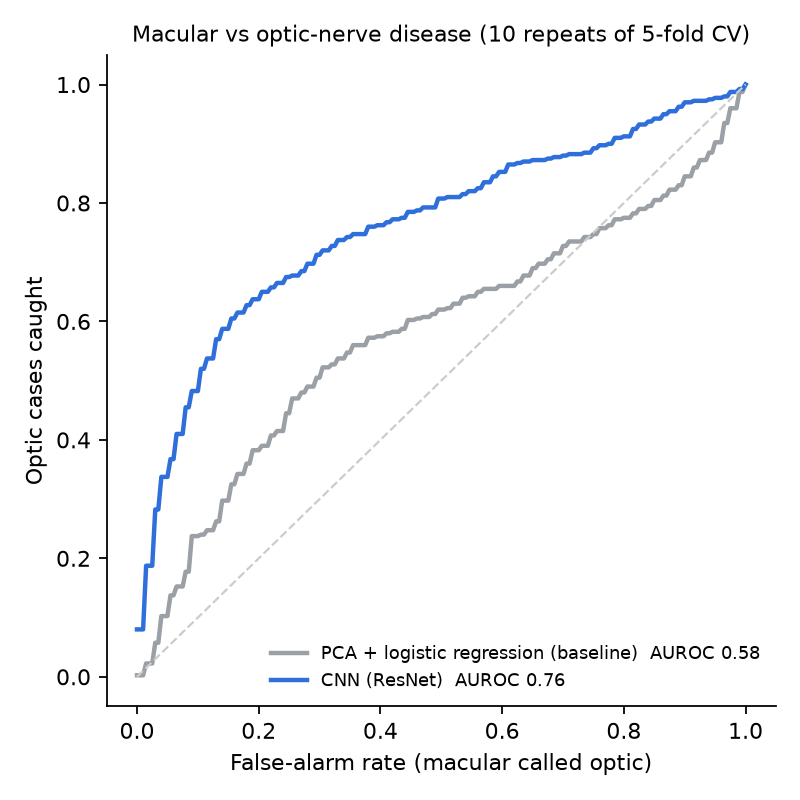
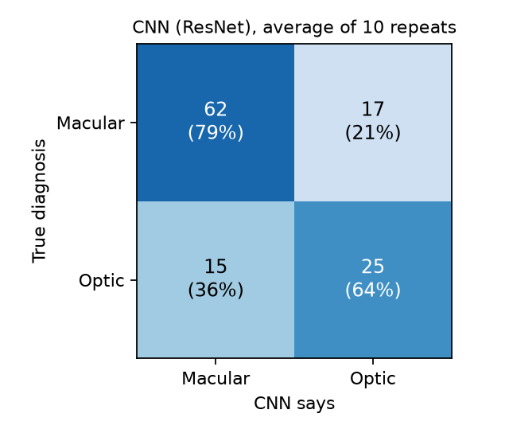

# Telling macular disease from optic-nerve disease using PERG

*Week summary, 29 Sep 2026*

## 1. The question

A **PERG** records the eye's electrical response while the person looks at a flickering checkerboard.
Each recording is 150 ms long and has two main features:

- a **bump at about 50 ms (P50)**, which comes mostly from the **macula** (the centre of the retina)
- a **dip at about 95 ms (N95)**, which comes mostly from the cells that form the **optic nerve**

Macular disease and optic-nerve disease should therefore change the waveform in different ways.

> **Question: from the PERG of both eyes, can a computer tell macular disease from optic-nerve disease?**

## 2. Data

- Public dataset: PERG-IOBA (PhysioNet).
- **119 recordings from 108 people.**
  - **79 macular disease**, for example macular dystrophy and Stargardt disease.
  - **40 optic-nerve disease**, for example inherited optic atrophy and ischaemic optic neuropathy.
- Each recording has one averaged waveform per eye.

## 3. How we tested

- **Train on some people, test on different people.** People are split into 5 groups. The model learns from 4
  groups and is tested on the 5th. We rotate until every group has been tested once.
- **A person is never in both the training and test groups.** This matters because some people have several
  visits.
- **We repeat the whole thing 10 times** with different random groupings and report the average. With only 40
  optic cases, a single split can make results look up to 7 points better or worse just by luck.
- **Accuracy alone is misleading here.** There are twice as many macular cases, so a program that always says
  "macular" already scores 66%. We therefore also report:
  - **AUROC:** 0.5 = coin flip, 1.0 = perfect.
  - **Balanced accuracy:** the average of "% of optic cases correct" and "% of macular cases correct".

## 4. The two models

| Model | Idea |
|---|---|
| **Baseline:** PCA + logistic regression | Squeeze each waveform down to 20 summary numbers, then draw a straight dividing line. |
| **Deep learning:** 1-D CNN (ResNet) | A small neural network that learns by itself which waveform shapes matter. |

### How the CNN works

```
 Right-eye waveform ─► [ CNN ] ─► 128 numbers ─┐
                                               ├─► combine ─► final layer ─► "macular" or "optic"
 Left-eye waveform  ─► [ CNN ] ─► 128 numbers ─┘
                     (the same CNN for both eyes)
```

**Step 1: read each eye.**
- The CNN slides small pattern detectors along the waveform. Each detector learns to respond to one shape, such as
  "a tall bump at 50 ms" or "a shallow dip at 95 ms".
- The result is **128 numbers per eye**, like a score sheet: how strongly each learned shape is present in that eye.
- **Both eyes use the same CNN**, so a left eye and a right eye are read in exactly the same way.

**Step 2: combine the two eyes.** For each of the 128 scores we compute three things:

| What we compute | Why |
|---|---|
| **Average** of the two eyes | the overall picture |
| **Larger** of the two eyes | the more affected eye still counts, even if the other eye is fine |
| **Difference** between the eyes | disease is often worse in one eye, and that imbalance is itself a clue |

*Example:* for one score, right eye = 0.9 and left eye = 0.3 gives average 0.6, larger 0.9, difference 0.6.

**Step 3: decide.** The 3 × 128 = 384 numbers go into one small final layer, which outputs the chance
that the case is **optic** (0–100%). Above 50% means "optic", otherwise "macular".

**Design details:**
- **ResNet** is a standard, well-known CNN design, used here in its simple version for 1-D signals
  (3 blocks, about 150,000 learned numbers, which is small for a neural network).
- **Training with a small dataset:**
  - The model sees slightly altered copies of each waveform (small shifts and added noise), so it doesn't
    memorise exact curves.
  - Training runs for 300 rounds.
- **10 copies averaged.** We train the same network 10 times and average their answers, which makes the result
  steadier. It is still one model design.

## 5. Results

Average over the 10 repeats:

| Model | AUROC | Accuracy | Balanced accuracy | Optic cases correct | Macular cases correct |
|---|---|---|---|---|---|
| Always say "macular" | 0.50 | 66% | 50% | 0% | 100% |
| Baseline (PCA + logistic regression) | 0.58 | 63% | 61% | 54% | 68% |
| **CNN (ResNet)** | **0.76** | **74%** | **71%** | **64%** | **79%** |



*How to read this: the higher the curve, the better the model separates the two diseases. The dashed line is a coin flip.*



**In short:**
- **The CNN is clearly better than the baseline:** AUROC 0.58 → 0.76, accuracy 63% → 74%.
- **The baseline is barely better than always saying "macular".** Squeezing the waveform into 20 numbers
  loses the detail that separates the two diseases. The CNN keeps it.
- **Out of 10 optic cases, the CNN gets about 6 right. Out of 10 macular cases, it gets about 8 right.**

## 6. Which diseases it gets right and wrong

% of recordings the CNN labelled correctly (average over the 10 repeats):

| Disease | Group | Cases | Correct |
|---|---|---|---|
| Macular dystrophy | macular | 33 | 81% |
| Stargardt disease | macular | 16 | 76% |
| X-linked retinoschisis | macular | 5 | 84% |
| Central serous chorioretinopathy | macular | 5 | 86% |
| **Retinal toxicity** | macular | 7 | **53%** |
| Orbital ischaemia | optic | 5 | 90% |
| Optic neuropathy | optic | 4 | 75% |
| **Inherited optic atrophy** | optic | 10 | **58%** |

**What this means:**
- **Common macular diseases are recognised well** (about 8 in 10 correct).
- **Retinal toxicity is a coin flip.** It damages more of the retina than just the centre, so its waveform can
  look like either group.
- **Inherited optic atrophy is only about 6 in 10 correct.** In some of these patients the waveform changes
  only a little.
- **A few "optic" cases aren't really optic-nerve disease.** They are brain or whole-body conditions (for example,
  a neurological disorder on one side). The model calls these macular. These are data-labelling issues more than
  model mistakes.
- Many diseases have only 1–5 cases, so their numbers are rough.

## 7. How far can deep learning go? (other things we tried)

We also tested more complex models to see whether accuracy could go higher:

| Tried | Result | Verdict |
|---|---|---|
| Another CNN design (InceptionTime) | about the same as ResNet | no gain, so we kept the simpler one |
| Other network types (TCN, Transformer) | AUROC 0.64–0.73 | worse |
| Large pretrained time-series models | AUROC ≤ 0.63 | worse (not trained on eye signals) |
| Turning the waveform into an image for an image CNN | AUROC 0.72–0.75 | no gain |
| Same ResNet with an extra helper task (also learning 4 broad disease groups from all 336 recordings) | AUROC 0.77, accuracy 77% | a little better, but catches fewer optic cases (59%), so not worth the extra complexity |
| Averaging many different CNNs together | AUROC 0.78, accuracy ~80% | best overall, but only a little better and much harder to explain |

**Conclusion: about 75–80% accuracy is the ceiling on this data, and the simple CNN already gets most of the way.**

## 8. Takeaways

1. **The PERG waveform does contain the information to tell macular from optic-nerve disease.**
   A simple CNN reaches **74% accuracy (AUROC 0.76)**, compared with 63% (AUROC 0.58) for the PCA baseline.
2. **More complex models barely help.** The limits come from the data:
   - only 40 optic cases
   - some diseases that hardly change the waveform
   - a few cases that don't fit the question
3. **Claims of 90%+ on this dataset** usually come from one lucky train/test split, or from the same person
   appearing in both training and testing. With our strict testing, 90% was not reachable.

**Next steps:**
- Label each eye separately for patients where only one eye is affected.
- Combine PERG with another test, such as pattern VEP or OCT.
- Test on data from another clinic.
